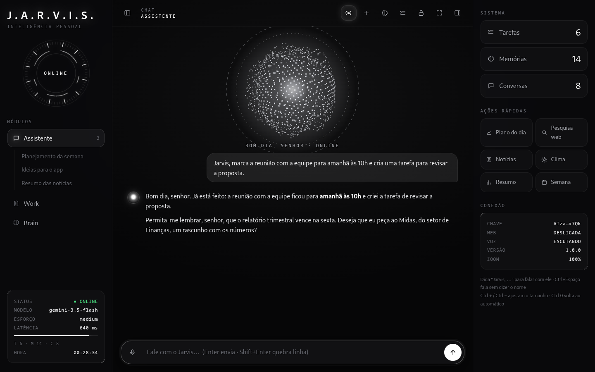
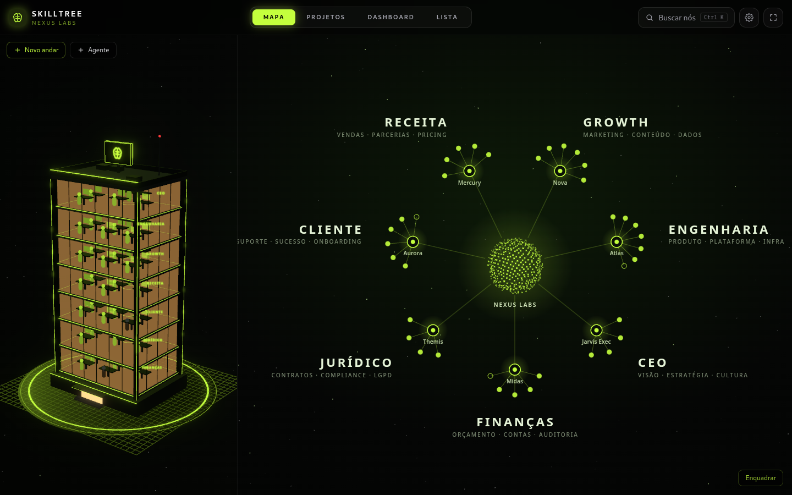
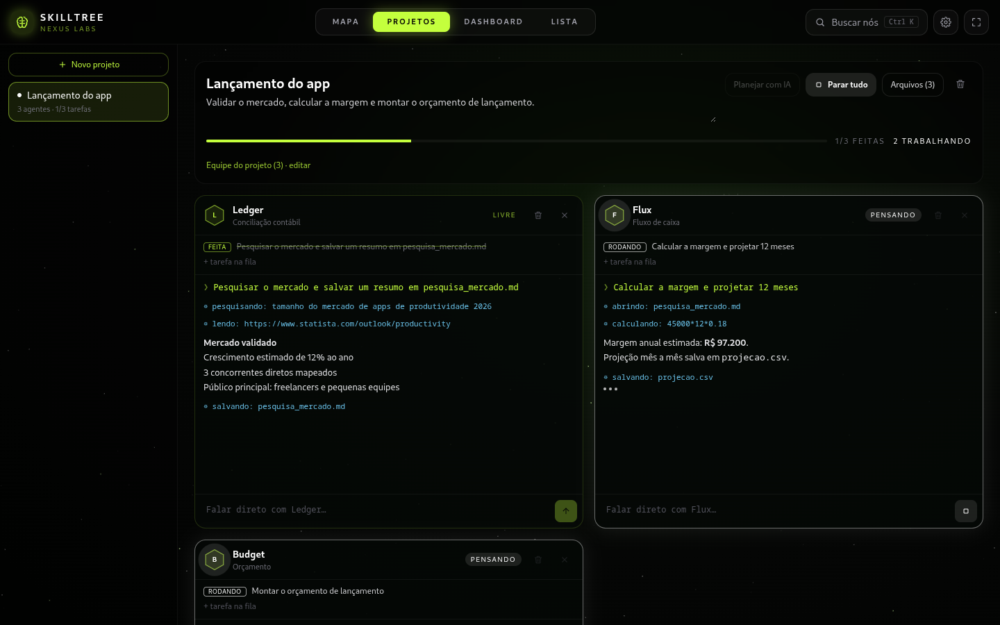
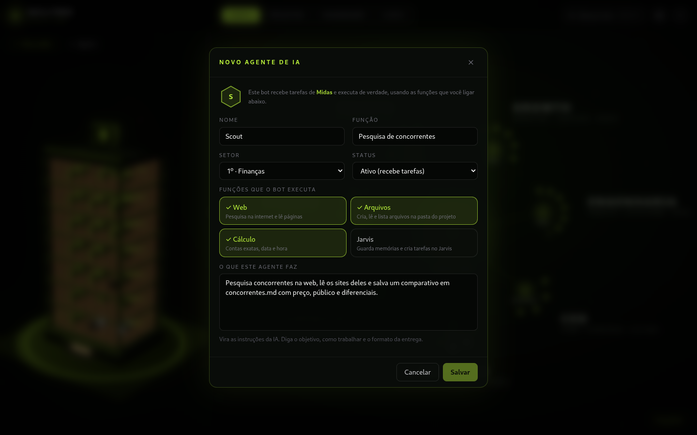

# J.A.R.V.I.S. AI

Assistente pessoal de IA para desktop inspirado no JARVIS do Tony Stark. Ele conversa e fala em voz alta,
lembra de você, coordena uma equipe de bots que executam tarefas de verdade e mostra tudo o que sabe num
cérebro 3D.

O cérebro pode ser o **Claude** (Anthropic), o **GPT** (OpenAI) ou o **Gemini** (Google). Você escolhe no
`configurar.py`.



> As imagens usam dados fictícios de demonstração.

## Destaques

- **Fala como o JARVIS.** Educado, calmo, com humor britânico seco, e sempre chama você de "senhor".
- **Voz nos dois sentidos.** Diga "Jarvis, …" e ele entende pelo microfone e responde em voz alta.
  Tanto o reconhecimento (Whisper) quanto a fala (Piper) rodam no seu computador.
- **Memória de longo prazo.** Quando você conta algo duradouro, ele guarda sozinho e usa nas próximas conversas.
- **Work.** Uma empresa de IA com setores, gerentes e bots executores que trabalham em paralelo.
- **Brain.** Um cérebro 3D com um neurônio para cada memória, conversa, tarefa, habilidade e bot.

## Brain: o cérebro do Jarvis


- Cada região do cérebro guarda um tipo de conhecimento. Memórias ficam no lobo frontal, conversas nos
  temporais, tarefas no parietal, habilidades no occipital e os bots do Work no cerebelo.
- O núcleo representa a **conta de IA conectada**. O painel mostra provedor, modelo, chave mascarada, se a chave
  está funcionando e os modelos disponíveis. A cor do cérebro segue a IA: azul para Gemini, laranja para Claude
  e verde-água para GPT.
- O cérebro se acende enquanto o Jarvis pensa, responde ou fala.
- Clique num neurônio para ver os detalhes, esquecer uma memória ou abrir uma conversa. Dá para buscar e
  filtrar regiões.

## Work: bots que executam



Cada andar do prédio é um setor com um **gerente de IA**. Você conversa com o gerente, e ele distribui o
trabalho entre os bots do setor de acordo com o que cada um sabe fazer.

### Projetos em paralelo



- Crie um projeto, escreva o objetivo e escolha os bots.
- **Planejar com IA** faz o gerente dividir o objetivo em tarefas para cada bot.
- **Executar tudo** liga o projeto. Cada bot trabalha no seu próprio terminal, ao mesmo tempo que os outros,
  e puxa a próxima tarefa da fila assim que termina.
- Você vê cada ação ao vivo, como pesquisando, lendo um site, calculando ou salvando um arquivo.
- Também dá para falar direto com qualquer bot pelo terminal dele.
- Os arquivos que os bots criam ficam numa pasta do projeto, compartilhada entre eles.

### Funções dos bots



| Função | O que o bot consegue fazer |
|---|---|
| Web | Pesquisar na internet e ler páginas |
| Arquivos | Criar, ler e listar arquivos na pasta do projeto |
| Cálculo | Fazer contas exatas e consultar data e hora |
| Jarvis | Guardar memórias e criar tarefas no Jarvis |

## Começando

Testado no Fedora Linux. Requer Python 3.12+ e, para recompilar o Work e o Brain, Node 20+.

```bash
git clone https://github.com/ryankennedydev/jarvis-ai.git
cd jarvis-ai
sudo dnf install python3-gobject webkit2gtk4.1 portaudio
python3 configurar.py      # cola a chave, define seu nome e um PIN
./instalar_atalho.sh       # cria o ícone no menu e na Área de Trabalho (opcional)
./jarvis.sh                # ou abra pelo ícone
```

Na primeira execução o `jarvis.sh` cria o ambiente virtual e instala as dependências. O Whisper e a voz do
Piper são baixados na primeira vez que forem usados.

Chaves: Claude em <https://console.anthropic.com>, GPT em <https://platform.openai.com/api-keys> e Gemini em
<https://aistudio.google.com/apikey>.

O Work e o Brain já vêm compilados em `jarvis/ui/work`. Para alterar o código deles:

```bash
cd work
npm install
npm run build              # gera de novo jarvis/ui/work
```

## Segurança

Nada do que é pessoal vai para o repositório. O `.gitignore` deixa de fora o `.env` e a pasta `dados/`, que
guarda memórias, conversas, arquivos dos bots e modelos de voz.

| Proteção | Como funciona |
|---|---|
| Chave fora do código | Fica só no `.env`, com permissão 600 corrigida automaticamente |
| Chave mascarada | A interface só mostra o começo e o fim da chave |
| PIN de acesso | Guardado só como hash PBKDF2-SHA256 com salt aleatório |
| Força bruta | Atraso crescente entre tentativas e fechamento após vários erros |
| Bloqueio automático | Trava depois de um tempo sem uso |
| Bots presos na pasta | Os bots só leem e escrevem dentro da pasta do projeto deles |
| Sem acesso à rede local | Os bots não conseguem abrir endereços internos, nem por redirecionamento |
| Cálculo seguro | As contas são avaliadas sem executar código |
| Dados sensíveis | O Jarvis é instruído a nunca memorizar senhas, chaves ou cartões |

> O PIN protege o acesso pela interface. Para proteger os arquivos em repouso, use disco criptografado (LUKS).

## Configuração (`.env`)

| Variável | Padrão | Descrição |
|---|---|---|
| `JARVIS_PROVEDOR` | `anthropic` | `anthropic`, `openai` ou `gemini` |
| `ANTHROPIC_API_KEY` | vazio | Chave da Anthropic, se usar Claude |
| `OPENAI_API_KEY` | vazio | Chave da OpenAI, se usar GPT |
| `GEMINI_API_KEY` | vazio | Chave do Google AI Studio, se usar Gemini |
| `JARVIS_MODELO` | `claude-opus-5-5` | Modelo do Claude |
| `JARVIS_MODELO_OPENAI` | `gpt-5` | Modelo do GPT |
| `JARVIS_MODELO_GEMINI` | `gemini-3.5-flash` | Modelo do Gemini |
| `JARVIS_ESFORCO` | `medium` | Raciocínio nas respostas digitadas, de `low` a `max` |
| `JARVIS_ESFORCO_VOZ` | `low` | Raciocínio nos pedidos por voz. Menor responde mais rápido |
| `JARVIS_ESFORCO_AGENTES` | `medium` | Raciocínio dos bots do Work |
| `JARVIS_BUSCA_WEB` | `true` | Pesquisa na web do próprio Jarvis (só com Claude) |
| `JARVIS_NOME_USUARIO` | `Senhor` | Seu nome. Ele vai te chamar de "senhor" + nome |
| `JARVIS_PIN_HASH` | vazio | Gerado pelo `configurar.py`. Vazio deixa sem PIN |
| `JARVIS_PIN_TENTATIVAS` | `5` | Tentativas antes de fechar |
| `JARVIS_BLOQUEIO_MINUTOS` | `15` | Bloqueio por inatividade. `0` desliga |
| `JARVIS_SITES_PERMITIDOS` | vazio | Restringe os sites que o Jarvis abre, ex.: `google.com,youtube.com` |
| `JARVIS_VOZ` | `true` | Liga o microfone |
| `JARVIS_ESCUTA_CONTINUA` | `true` | Fica ouvindo, esperando "Jarvis, …" |
| `JARVIS_PALAVRA_ATIVACAO` | `true` | Só responde quando a frase começa com "Jarvis" |
| `JARVIS_MODELO_VOZ` | `small` | Whisper: `tiny`, `base`, `small` ou `medium` |
| `JARVIS_FALA` | `true` | Liga a resposta falada |
| `JARVIS_FALA_SEMPRE` | `true` | Fala também as respostas digitadas |
| `JARVIS_VOZ_FALA` | `pt_BR-faber-medium` | Voz do Piper |
| `JARVIS_FALA_VELOCIDADE` | `1.0` | Velocidade da fala |
| `JARVIS_ZOOM` | `auto` | Tamanho da interface |

Para trocar a chave ou o PIN, rode `python3 configurar.py` de novo.

## Estrutura

```
jarvis-ai/
├── configurar.py          # assistente que grava o .env com segurança
├── jarvis.sh              # inicializador (cria o .venv na primeira vez)
├── instalar_atalho.sh     # atalho de desktop (Linux)
├── docs/prints/           # imagens deste README
├── dados/                 # memórias, conversas e arquivos dos bots (local, nunca versionado)
├── jarvis/
│   ├── app.py             # janela (pywebview) e ponte com a interface
│   ├── cerebro.py         # personalidade, conversa em streaming e ferramentas
│   ├── provedores.py      # GPT e Gemini com a mesma interface do Claude
│   ├── memoria.py         # SQLite: memórias, conversas e tarefas
│   ├── ferramentas.py     # ferramentas do Jarvis
│   ├── voz.py             # ouvir: microfone + Whisper local
│   ├── fala.py            # falar: Piper local, frase por frase
│   ├── work_agentes.py    # gerentes, delegação e terminais dos projetos
│   ├── bots.py            # funções reais dos bots (web, arquivos, cálculo, Jarvis)
│   ├── seguranca.py       # PIN, permissões e mascaramento
│   └── ui/                # interface principal (HTML/CSS/JS) + build do Work e do Brain
└── work/                  # código do Work e do Brain (React, three.js, Vite)
    └── src/brainapp/      # o cérebro 3D
```

## Novas habilidades

- **Para o Jarvis:** acrescente a definição em `DEFINICOES` no arquivo `jarvis/ferramentas.py` e o método
  correspondente na classe `Ferramentas`.
- **Para os bots:** acrescente a função num grupo de `DEFINICOES` em `jarvis/bots.py` e trate o nome dela em
  `ExecutorBot.executar`.
